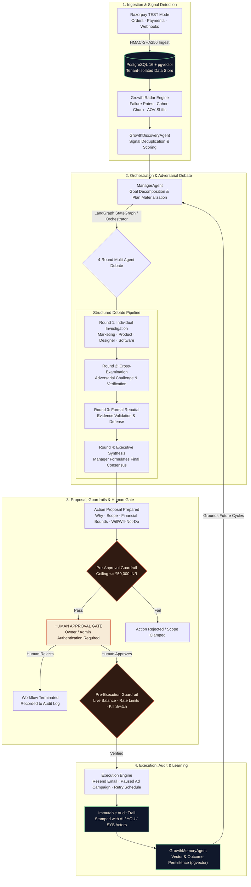

<div align="center">

# 🚀 RazorGrowth AI
### **The Autonomous Merchant Growth & Agentic Commerce Engine for Razorpay**

<p align="center">
  <b>Ingesting real commerce data · Coordinating 14 specialized AI agents · Debating growth hypotheses · Enforcing double guardrails · Gated by human approval</b>
</p>

[](https://fastapi.tiangolo.com)
[](https://react.dev)
[](https://vitejs.dev)
[](https://github.com/pgvector/pgvector)
[](https://langchain-ai.github.io/langgraph/)
[](https://razorpay.com)
[](https://developers.cloudflare.com/workers-ai/)
[](#-testing-and-verification)
[](LICENSE)

<br/>

<a href="#quick-start">
  
</a>
&nbsp;
<a href="#the-14-agent-growth-team">
  
</a>
&nbsp;
<a href="#system-architecture">
  
</a>

<br/><br/>

<p align="center">
  
</p>

</div>

---

### <a id="executive-summary"></a>⚡ Executive Summary

> **RazorGrowth AI** is an AI-powered merchant growth and agentic commerce platform designed to help digital businesses understand growth opportunities, coordinate specialized AI agents, and execute controlled growth workflows.
>
> Modern e-commerce businesses generate immense volumes of transactional data — successful payments, failed checkouts, customer churn signals, product affinities, and catalog shifts — yet turning this stream into revenue-generating execution remains slow, manual, and error-prone. Traditional "AI assistants" act as opaque, ungrounded black boxes that hallucinate numbers and cannot be trusted with monetary execution.
>
> **RazorGrowth AI solves this fundamental gap.** It acts as an autonomous, multi-agent growth department that ingests verified Razorpay TEST-mode commerce data, detects underlying growth signals across revenue and customer cohorts, convenes a team of 14 specialized AI agents to investigate and cross-examine findings through structured multi-round debate, synthesizes explainable action proposals bounded by strict financial ceilings, and requires explicit merchant human approval before triggering idempotent, double-guardrailed execution. Every step, tool invocation, and human decision is immutably recorded in an audit trail.

---

## 📑 Table of Contents

- [Executive Summary](#executive-summary)
- [The Problem RazorGrowth AI Solves](#the-problem-razorgrowth-ai-solves)
- [Core Platform Capabilities](#core-platform-capabilities)
- [Verified Product Experience](#verified-product-experience)
- [How It Works — End-to-End Visual Workflow](#how-it-works--end-to-end-visual-workflow)
- [The 14-Agent Growth Team](#the-14-agent-growth-team)
  - [Main Growth Team (Collaborative Debate & Planning)](#main-growth-team)
  - [Domain Specialists (Analysis & Decisioning Engine)](#domain-specialists)
  - [Canonical Tool Catalog & Strict Permission Model](#canonical-tool-catalog)
- [Multi-Agent Orchestration & LangGraph](#multi-agent-orchestration--langgraph)
  - [Execution Modes & Plans](#execution-modes-and-plans)
  - [LangGraph StateGraph Integration](#langgraph-stategraph-integration)
  - [Durable Lifecycle, Lease Fencing & Recovery](#durable-lifecycle-and-recovery)
- [The 4-Round Agent Debate Protocol](#the-4-round-agent-debate-protocol)
- [Human-in-the-Loop Safeguards & Double Guardrails](#human-in-the-loop-safeguards--double-guardrails)
- [External Integrations & Execution Layer](#external-integrations--execution-layer)
- [System Architecture](#system-architecture)
- [Technology Stack](#technology-stack)
- [Repository Structure](#repository-structure)
- [Quick Start](#quick-start)
  - [One-Command Docker Deployment (Recommended)](#docker-deployment)
  - [Local Development Setup](#local-setup)
- [Environment Configuration](#environment-configuration)
- [Database Setup & Alembic Migrations](#database-setup--alembic-migrations)
- [API Usage & Endpoints](#api-usage--endpoints)
- [Testing and Verification](#testing-and-verification)
- [Configuration & Troubleshooting](#configuration--troubleshooting)
- [Implementation Status & Honest Engineering Boundaries](#implementation-status--honest-engineering-boundaries)
- [Product Roadmap](#product-roadmap)
- [Contributing Guidelines](#contributing-guidelines)
- [License & Acknowledgments](#license--acknowledgments)

---

## <a id="the-problem-razorgrowth-ai-solves"></a>🎯 The Problem RazorGrowth AI Solves

Merchants operating on payment gateways like Razorpay capture continuous transactional reality: completed checkouts, recurring subscriptions, high-value cart abandonments, technical card declines, and shifting SKU affinities. However, extracting actionable commercial lift from this data presents critical bottlenecks:

| Traditional Commerce Operations | Unbounded Generative AI "Copilots" | **RazorGrowth AI Platform** |
|:---|:---|:---|
| **Siloed Analysis**: Merchant data lives across SQL databases, gateway dashboards, and analytics tools. Growth analysis is manual, sporadic, and delayed by weeks. | **Hallucinated Recommendations**: General-purpose LLMs generate unsubstantiated recommendations disconnected from real unit economics and verified ledger data. | **Deterministic Signal Grounding**: 100% of insights originate from real transaction logs via PostgreSQL queries, deterministic scoring engines, and RAG knowledge retrievals. |
| **Monolithic Decision Making**: A single marketer or developer attempts to plan retention campaigns, write ad copy, analyze failed payments, and design A/B experiments. | **Single-Agent Blindspots**: A lone LLM prompt produces uncritical, agreeable responses without internal challenge, counter-argument, or feasibility auditing. | **14-Agent Collaborative Division of Labor**: Specialized agents cross-examine hypotheses in a 4-round adversarial debate (Marketing, Product, Design, Tech, Finance). |
| **High Financial Risk**: Manual campaigns and automated scripts can inadvertently over-discount products, blast wrong customer segments, or exhaust budgets. | **Uncontrolled Execution**: Granting agents direct API keys or money-transfer access creates massive liability and catastrophic failure risk. | **Structurally Enforced Human-in-the-Loop**: Agents hold zero execution or approval permissions. All write actions land in `requested` state, awaiting human owner/admin approval behind double guardrails. |
| **No Accountability**: When campaigns fail, teams cannot determine why an action was recommended, what data informed it, or what alternatives were rejected. | **Black-Box Outputs**: No durable logs of agent reasoning, tool payloads, intermediate findings, or external network calls. | **Immutable Audit Trail**: Every tool call, agent finding, debate turn, human approval, and execution step is stamped with `AI`, `YOU`, or `SYS` actor markers. |

---

## <a id="core-platform-capabilities"></a>✨ Core Platform Capabilities

### 📡 1. Real-Data Growth Radar
A live diagnostic command center computed directly from ingested Razorpay TEST data. Calculates net captured revenue, transactions, active customer count, order volumes, average order value (AOV), and payment failure ratios. Detects ranked growth signals across revenue momentum, repeat-purchase decay, dormant customer cohorts, and anomalous order behavior — accompanied by an honest, plain-English executive summary. Missing data produces clear empty states, never synthesized mock statistics.

### 🧠 2. 14-Agent Coordinated Intelligence
A multidisciplinary virtual growth department composed of **5 Main Growth Team agents** (Manager, Marketing, Product, Designer, Software) and **9 Domain Specialists** (Growth Discovery, Customer Intelligence, Revenue Optimization, Campaign Strategy, Payment Recovery, Opportunity Prioritization, Experimentation, Growth Memory, and Personalization). Every agent operates under a strict capability model that structurally forbids money manipulation or autonomous action approval.

### ⚖️ 3. 4-Round Structured Multi-Agent Debate
Specialists do not operate in silos. In `growth_team` mode, agents engage in a formal 4-round debate: **Investigation → Cross-Examination → Rebuttal → Executive Synthesis**. Findings are classified into *supporting*, *opposing*, and *uncertainty* categories. A context-aware chat assistant on the debate interface enables merchants to inspect specific debate dynamics ("Why did Software challenge Product's recommendation?", "What evidence supported this discount?").

### 🛡️ 4. Explainable, Bounded Actions & Human Approval Gate
Every proposed growth initiative is:
- **Explainable**: Contains the exact commercial rationale, supporting data points, target customer segment, and expected revenue impact.
- **Bounded**: Includes an explicit list of *what the action will do* and *what it will never do*, capped by hard financial ceilings (`GUARDRAIL_MAX_AMOUNT_INR`) and audience volume limits.
- **Human-Gated**: Agents can only *propose* (`requested` state). Execution requires explicit authentication and cryptographic signature by a verified workspace `owner` or `admin`.

### 🤖 5. Autonomous AI Buyer Checkout
A fully realized autonomous buyer module designed to test and validate agentic commerce. The AI Buyer inspects the merchant's live catalog, selects products at their real prices, creates genuine Razorpay TEST orders, and verifies payment signatures. Failures (such as declined test cards) trigger honest, graceful degradation: no funds captured, no infinite retries, and clear recovery telemetry.

### 🔌 6. Enterprise Integration Layer (Marketing AGI)
External marketing execution connects to verified third-party providers: **Resend** (Email campaigns), **Google Ads** (OAuth2 + Developer token), **Meta Ads**, and **Instagram** (OAuth2). Per-workspace credentials are encrypted at rest using Fernet keys (`integration_connections` table). Read actions are autonomous when connected; write actions (`send_email`, `create_campaign_paused`, `publish_photo`) are strictly approval-gated through the Actions pipeline.

### 🔐 7. Multi-Tenant Architectural Isolation
JWT-authenticated session security with scrypt password hashing, session revocation, and fine-grained role-based access control (`owner`, `admin`, `operator`, `analyst`). Every database query enforces tenant scoping (`merchant_id`). Cross-tenant access attempts immediately yield `403 Forbidden` responses. Razorpay records are tied immutably to a single merchant workspace and cannot be accessed across boundaries.

### 🧮 8. Resilient Multi-Provider LLM & RAG Layer
Unified model provider abstraction routing between **Cloudflare Workers AI** (the platform default) and **OpenAI**, governed by the `LLM_PROVIDER` environment variable. Zero unannounced fallbacks: if no provider is configured, agents degrade gracefully to deterministic analytical modes rather than fabricating claims or leaking data to unauthorized external endpoints.

---

## <a id="verified-product-experience"></a>🖼️ Verified Product Experience

RazorGrowth AI features a custom-built, warm editorial design system combining retro-computing aesthetics with high-density data visualization (built with Archivo Variable typography, IBM Plex Mono code elements, paper-cream surfaces, and terracotta/coral accents).

<br/>

<div align="center">
  <table>
    <tr>
      <td width="50%">
        
        <p align="center"><b>Live Merchant Workspace & Growth Radar</b><br/><i>Real-time transaction signals, revenue trends, and priority opportunity queue.</i></p>
      </td>
      <td width="50%">
        
        <p align="center"><b>Designer Agent Creative Studio</b><br/><i>Autonomous campaign brief synthesis, typography specs, and FLUX visual generation.</i></p>
      </td>
    </tr>
  </table>
</div>

### Shipped Frontend Experience Routes
- **`/`**: Public product landing page, manifesto, interactive merchant world canvas, and feature architecture.
- **`/growth-radar`**: Real-time business diagnostic radar computed directly from PostgreSQL transaction tables.
- **`/agents`**: Coordinated 14-Agent Growth Team dashboard displaying active statuses, tool capabilities, and run logs.
- **`/manager-agent`**: Manager Agent autonomous coordinator panel (goal intake, validated execution planning, workflow status).
- **`/marketing-agent`**: Marketing AGI workstation (integrations stack with Resend, Google Ads, Meta Ads, Instagram).
- **`/designer-agent`**: Creative studio for asset review, brief generation, and Cloudflare FLUX image synthesis.
- **`/product-agent`**: Product catalog intelligence, SKU affinity mapping, and basket bundle discovery.
- **`/software-agent`**: Technical feasibility and integration architecture analysis console.
- **`/debate`**: Multi-agent adversarial debate viewer with round-by-round cross-examination cards and debate chat assistant.
- **`/actions`**: Growth Actions approval console featuring double-guardrail status and immutable audit timeline.
- **`/checkout`**: Live AI Buyer simulator running genuine Razorpay TEST transactions against merchant products.

---

## <a id="how-it-works--end-to-end-visual-workflow"></a>🔄 How It Works — End-to-End Visual Workflow

The platform enforces a deterministic, multi-stage progression from raw payment events to human-approved execution:



---

## <a id="the-14-agent-growth-team"></a>🧠 The 14-Agent Growth Team

The RazorGrowth AI agent system is defined authoritatively in `backend/app/agents/registry.py`. Every agent inherits from `BaseGrowthAgent` (`backend/app/agents/base.py`) and declares an explicit capability boundary.

### <a id="main-growth-team"></a>1. Main Growth Team (Collaborative Debate & Planning)

The 5 main growth agents collaborate in high-level strategic planning, cross-functional debate rounds, and executive synthesis.

| Agent | Core Responsibility | Key Inputs | Primary Outputs | Execution Role |
|:---|:---|:---|:---|:---|
| **`ManagerAgent`** | Top-level coordinator. Decomposes objectives into validated execution plans, delegates tasks, directs debate rounds, synthesizes final consensus. | Merchant RAG context, strategic objectives, cross-agent debate findings | Materialized action plans, debate direction, executive synthesis | Orchestrator & Debater |
| **`MarketingAgent`** | Analyzes customer cohorts, retention rates, win-back opportunities, messaging strategy, and channel ROI. | Customer intelligence data, transaction recency/frequency metrics | Retention campaign blueprints, target audience specifications | Debate Specialist |
| **`ProductAgent`** | Discovers product affinities, cross-sell/upsell pairs, inventory velocity, and catalog pricing optimizations. | Order items, product catalog metadata, historical basket combinations | Product bundling opportunities, SKU affinity matrices | Debate Specialist |
| **`DesignerAgent`** | Formulates creative messaging concepts, ad variants, visual UX briefs, and generates campaign visuals. | Strategic recommendations, customer persona data, brand parameters | Creative design briefs, copy variants, FLUX visual assets | Creative Specialist |
| **`SoftwareAgent`** | Evaluates technical feasibility, API prerequisites, integration constraints, and architectural requirements. | Proposed marketing/product actions, system integration contracts | Technical implementation specs, API dependency reports | Feasibility Specialist |

### <a id="domain-specialists"></a>2. Domain Specialists (Analysis & Decisioning Engine)

Nine specialized domain agents handle high-depth, deterministic analysis and opportunity generation.

| Agent | Core Responsibility | Key Inputs | Primary Outputs | Status & Catalogued Tools |
|:---|:---|:---|:---|:---|
| **`GrowthDiscoveryAgent`** | Ingests Growth Radar signals and converts raw business anomalies into scored growth opportunities. | Raw payment and order telemetry, radar anomaly signals | Deduplicated, ranked growth opportunities with confidence metrics | `analytics.growth_radar`<br/>`opportunities.rank` |
| **`CustomerIntelligenceAgent`** | Computes RFM scores, Customer Lifetime Value (LTV), churn probability, and customer health segments. | Customer profiles, historical payment logs, order frequency | Customer segment classifications, churn-risk alerts | `customer.insights` |
| **`RevenueOptimizationAgent`** | Evaluates price elasticity, models promotion economics, and prepares bounded financial propositions. | Open growth opportunities, margin data, historical orders | Bounded discount and revenue recovery proposals | Deterministic Scoring Engine |
| **`CampaignStrategistAgent`** | Architectures targeted marketing initiatives, matching customer segments with appropriate communication channels. | Customer cohorts, validated opportunities, channel history | Structured campaign blueprints awaiting human approval | Bounded Campaign Engine |
| **`PaymentRecoveryAgent`** | Analyzes failed Razorpay transactions using classification heuristics and schedules bounded recovery actions. | Failed payment records, gateway error codes, order links | Bounded retry actions, customer recovery email proposals | `payments.failure_analytics`<br/>`actions.propose` |
| **`OpportunityPrioritizationAgent`** | Applies deterministic multi-criteria scoring to prioritize the merchant's global opportunity queue. | Raw opportunity candidate list, merchant risk profile | Ranked, best-first opportunity queue | `opportunities.rank` |
| **`ExperimentAgent`** | Formulates statistically valid A/B experiment frameworks with explicit sample size criteria. | Top-ranked opportunities, baseline conversion metrics | Controlled experiment designs with test/control parameters | `experiments.design`<br/>`experiments.record_result` |
| **`GrowthMemoryAgent`** | Manages persistent merchant memory across execution cycles using vector similarity and historical audit records. | Post-execution outcome evaluations, historical audit logs | Contextual memory retrievals grounding new planning cycles | `memory.recall` |
| **`PersonalizationAgent`** | Determines deterministic next-best-action recommendations for individual customer profiles. | Customer RFM metrics, product affinity baskets, churn scores | Individualized personalization decisions with evidence records | `customer.insights`<br/>`commerce.catalog_intelligence` |

### <a id="canonical-tool-catalog"></a>3. Canonical Tool Catalog & Strict Permission Model

Every capability invoked by an agent is registered in `backend/app/agents/catalog.py` and strictly checked against `backend/app/agents/permissions.py`.

```
CANONICAL TOOL INVENTORY (12 Verified Tools):
├── analytics.business_overview       [read_merchant]       → AnalyticsService.get_overview
├── analytics.growth_radar            [read_orders]         → GrowthRadarService.detect
├── customer.insights                 [read_customers]      → CustomerIntelligenceService.compute_metrics
├── commerce.catalog_intelligence     [read_products]       → ProductIntelligenceService (stock, pricing)
├── payments.failure_analytics        [read_payments]       → PaymentRecoveryService.get_failed_analytics
├── opportunities.rank                [read_opportunities]  → OpportunityScoringEngine.rank
├── experiments.design                [read_opportunities]  → ExperimentService.create_experiment
├── experiments.record_result         [read_opportunities]  → ExperimentService.record_result
├── research.web_search               [read_merchant]       → ResearchService.search (unconfigured default)
├── collaboration.request_handoff     [read_merchant]       → HandoffService.request (durable handoff)
├── memory.recall                     [read_merchant]       → GrowthMemoryService.retrieve
└── actions.propose                   [read_merchant]       → ActionService.create_action (requested only)
```

#### Structurally Forbidden Capabilities
The platform defines an immutable invariant in `FORBIDDEN_CAPABILITIES`:
```python
FORBIDDEN_CAPABILITIES: frozenset[str] = frozenset({
    "approve_action",
    "execute_action",
    "reject_action",
    "bypass_guardrails",
    "direct_database_mutation",
    "send_money",
})
```
No agent holds or can be granted these permissions. Proposing an action creates an `AgentAction` record locked in `requested` status; approval remains exclusive to human administrators.

---

## <a id="multi-agent-orchestration--langgraph"></a>⚙️ Multi-Agent Orchestration & LangGraph

The orchestration architecture operates through two complementary, production-grade layers:
1. **`GrowthAgentOrchestrator`** (`backend/app/agents/orchestrator.py`): Step-level savepoints, lease management, fencing tokens, and database transaction boundaries.
2. **`LangGraphWorkflowExecutor`** (`backend/app/ai/langgraph_orchestrator/`): Compiled `StateGraph` managing state transitions, conditional edges, checkpointers, and cancellation hooks across all 14 agents.

### <a id="execution-modes-and-plans"></a>Execution Modes & Plans

| Mode | Target Use Case | Pipeline Plan Execution | LLM Dependency |
|:---|:---|:---|:---:|
| **`fast`** | Instant diagnostic scan | `GrowthMemoryAgent` (load) → `GrowthDiscoveryAgent` → `PaymentRecoveryAgent` → `OpportunityPrioritizationAgent` | None (Deterministic) |
| **`deep`** | Comprehensive business audit | Memory (load) → Discovery → Customer Intelligence → Payment Recovery → Campaign Strategist → Revenue Optimization → Experiment Agent → Prioritization | Optional |
| **`growth_team`** | 4-round adversarial debate | Memory (load) → Manager (plan) → Round 1 (Investigate) → Round 2 (Cross-Examine) → Round 3 (Rebut) → Round 4 (Synthesize) → Memory (persist) | Active LLM |
| **`team`** | Full collaborative pipeline | 14-Agent sequential workspace execution including Personalization and Handoffs | Active LLM |

### <a id="langgraph-stategraph-integration"></a>LangGraph StateGraph Integration

LangGraph compiles an authoritative `StateGraph(GrowthWorkflowState)` wiring all agents into conditional execution paths:

```mermaid
flowchart LR
    START([START]) --> VR[validate_request]
    VR --> LC[load_context]
    LC --> ROUTE{Route by Mode}
    
    ROUTE -->|fast| FM[fast_memory_load] --> FD[fast_discovery] --> FP[fast_payment_recovery] --> FO[fast_prioritization] --> FW[finalize_workflow]
    
    ROUTE -->|deep| DM[deep_memory_load] --> DD[deep_discovery] --> DC[deep_customer_intel] --> DP[deep_payment_recovery] --> DCS[deep_campaign_strategist] --> DR[deep_revenue_opt] --> DE[deep_experiment] --> DO[deep_prioritization] --> DMP[deep_memory_persist] --> FW
    
    ROUTE -->|growth_team| GM[growth_team_memory_load] --> GP[growth_team_manager_plan] --> GDEB[4-Round Multi-Agent Debate] --> GS[growth_team_manager_synth] --> GMP[growth_team_memory_persist] --> FW
    
    FW --> END([END])
    
    classDef graphNode fill:#10182b,stroke:#d97757,stroke-width:1px,color:#f7ebd7;
    class VR,LC,FM,FD,FP,FO,DM,DD,DC,DP,DCS,DR,DE,DO,DMP,GM,GP,GDEB,GS,GMP,FW graphNode;
```



### <a id="durable-lifecycle-and-recovery"></a>Durable Lifecycle, Lease Fencing & Recovery

Long-running agent workflows are defended against server restarts, timeouts, and multi-process contention by `WorkflowRunService` (`backend/app/services/workflow_run_service.py`):
- **Compare-and-Set Leases (`claim`)**: Workers acquire an atomic database lease (`DEFAULT_LEASE_SECONDS = 900`). A crashed cycle older than `STALE_TAKEOVER_SECONDS = 120` can be taken over safely by a replacement worker.
- **Generation Fencing Tokens (`StaleLeaseError`)**: Every lease acquisition increments the workflow's generation token. If a slow worker awakens after losing its lease, its write operations are strictly rejected to prevent stale state corruption.
- **Deterministic Step Identity**: Step keys are generated from stable hashes of `(mode, index, agent_name, phase)`. Replays of completed steps reuse persisted outputs, while illegitimate duplicate executions are rejected by unique database constraints.
- **Plan Compatibility Fingerprints**: Workflows persist a cryptographic fingerprint of their planned steps. A resume request against a modified codebase plan refuses to graft mismatched results, ensuring strict state integrity.
- **Savepoint Isolation**: Each agent step executes inside a database `SAVEPOINT`. If an agent encounters an unhandled exception, only its step is rolled back and marked `failed`. The parent cycle records `partial_success` and continues cleanly.

---

## <a id="the-4-round-agent-debate-protocol"></a>⚖️ The 4-Round Agent Debate Protocol

In `growth_team` mode, RazorGrowth AI executes a structured, adversarial multi-agent debate that tests hypotheses from multiple business angles:

```mermaid
sequenceDiagram
    autonumber
    actor Merchant as Merchant (User / Admin)
    participant Mgr as ManagerAgent
    participant Mkt as MarketingAgent
    participant Prod as ProductAgent
    participant Des as DesignerAgent
    participant Soft as SoftwareAgent
    participant Act as Actions & Guardrails

    Merchant->>Mgr: Submit Objective / Trigger Analysis
    Note over Mgr: Phase: Delegate & Decompose
    Mgr->>Mkt: Investigate Customer Retention Signals
    Mgr->>Prod: Investigate Product Affinity & AOV
    Mgr->>Des: Investigate Messaging & Creative Fit
    Mgr->>Soft: Investigate Technical & API Prerequisites

    rect rgb(16, 24, 43)
        Note over Mkt,Soft: Round 1: Individual Investigation
        Mkt-->>Mgr: Finding: 24% churn in 60-day cohort (Supporting)
        Prod-->>Mgr: Finding: SKU A + SKU B bundle uplift potential (Supporting)
        Des-->>Mgr: Finding: Discount messaging fatigue detected (Opposing)
        Soft-->>Mgr: Finding: Razorpay webhook latency within bounds (Supporting)
    end

    rect rgb(33, 19, 14)
        Note over Mkt,Soft: Round 2: Adversarial Cross-Examination
        Mkt->>Des: Challenges creative fatigue with segmented email proof
        Prod->>Mkt: Questions whether discounting cannibalizes full-price repeat buyers
        Soft->>Prod: Flags catalog inventory constraint on SKU B
    end

    rect rgb(16, 24, 43)
        Note over Mkt,Soft: Round 3: Formal Rebuttal & Defense
        Mkt-->>Mgr: Concedes to exclude active 30-day VIP cohort
        Des-->>Mgr: Proposes non-monetary VIP loyalty copy variant
        Prod-->>Mgr: Adjusts bundle ratio to clear inventory safely
    end

    rect rgb(42, 24, 16)
        Note over Mgr: Round 4: Executive Synthesis
        Mgr->>Act: Synthesize Consensus into Bounded Action Proposal
    end

    Act-->>Merchant: Action Proposal Ready for Review (Status: Requested)
    Merchant->>Act: POST /api/actions/{id}/approve (Human Decision)
    Act->>Act: Verify Double Guardrails & Idempotency
    Act-->>Merchant: Action Executed & Stamped to Immutable Audit Log
```



---

## <a id="human-in-the-loop-safeguards--double-guardrails"></a>🛡️ Human-in-the-Loop Safeguards & Double Guardrails

RazorGrowth AI guarantees that autonomous agents can never trigger direct financial transactions, drain ad budgets, or modify external customer data without verification:

```mermaid
flowchart TD
    AGENT["AI Agent Proposes Growth Action"] --> PREP["Action Created in 'requested' Status<br/>Stored in agent_actions"]
    
    subgraph G1["First Guardrail Pass (Pre-Approval Evaluation)"]
        PREP --> CHK1{"Amount <= GUARDRAIL_MAX_AMOUNT_INR?<br/>Default: ₹50,000 INR"}
        CHK1 -->|Exceeded| AUTO_REJ["Marked as REJECTED<br/>Reason: GUARDRAIL_LIMIT_EXCEEDED"]
        CHK1 -->|Within Limit| AUD1["Audit Event Logged: action_proposed<br/>Actor: AI"]
    end
    
    AUD1 --> QUEUE["Action Placed in Merchant Approval Queue"]
    
    subgraph HUMAN_GATE["Human Gate (Owner / Admin Only)"]
        QUEUE --> REVIEW["Merchant Inspects Proposal<br/>Rationale · Evidence · Scope · Will/Will-Not-Do"]
        REVIEW --> DECISION{"Merchant Decision"}
        DECISION -->|Reject| REJ_ACT["Status: REJECTED<br/>Actor: YOU<br/>Audit Event: action_rejected"]
        DECISION -->|Approve| APP_ACT["Status: APPROVED<br/>Actor: YOU<br/>Audit Event: action_approved"]
    end
    
    subgraph G2["Second Guardrail Pass (Pre-Execution Re-check)"]
        APP_ACT --> RE_EVAL{"Re-validate Guardrails Live"}
        RE_EVAL -->|Fails| SAFE_STATE["Execution Aborted<br/>Safe State Persisted in Audit"]
        RE_EVAL -->|Passes| KILL_SW{"EXECUTION_ENABLED == true?"}
        KILL_SW -->|false (Default)| TEST_EXEC["Dry-Run / Test-Mode Response<br/>mode: 'test', executed: false<br/>Audit: action_executed_test_mode"]
        KILL_SW -->|true| LIVE_EXEC["Execute External Provider Call<br/>Resend / Google Ads / Meta Ads"]
        LIVE_EXEC --> AUD2["Audit Event: action_executed<br/>Actor: SYS · Idempotency Key Locked"]
    end

    classDef pass fill:#10182b,stroke:#70b88a,stroke-width:1px,color:#f7ebd7;
    classDef gate fill:#f7ebd7,stroke:#d97757,stroke-width:2px,color:#2a1810;
    classDef fail fill:#301b12,stroke:#c85f43,stroke-width:1px,color:#fff3df;

    class CHK1,RE_EVAL,KILL_SW pass;
    class REVIEW,DECISION,APP_ACT gate;
    class AUTO_REJ,REJ_ACT,SAFE_STATE fail;
```

---

## <a id="external-integrations--execution-layer"></a>🔌 External Integrations & Execution Layer

The **Marketing AGI** execution engine connects to external advertising, messaging, and CRM providers.

| Provider | Service Type | Authentication Method | Live Read Capabilities | Write Capabilities (Approval-Gated) |
|:---|:---|:---|:---|:---|
| **Resend** | Email Infrastructure | API Key + Verified Domain Sender | Sender verification, sending quota | `send_email` (segmented campaigns) |
| **Google Ads** | PPC / Search Ads | OAuth2 (Refresh Token) + Developer Token | Customer accounts, campaign lists, spend | `create_campaign_paused` (Paused by default) |
| **Meta Ads** | Social Ad Campaigns | OAuth2 Long-Lived Token + Ad Account ID | Ad accounts, campaigns, reach metrics | `create_campaign_paused` (Paused by default) |
| **Instagram** | Organic / Visual Feed | Shared Meta Graph OAuth2 Token | Account metrics, media publishing status | `publish_photo` (two-step upload & publish) |
| **Internal CRM** | Customer Profiles | Multi-tenant PostgreSQL session | RFM scores, LTV, churn history | Internal customer tagging & segmentation |

### Security Invariants for External Providers
1. **Live Handshake Verification**: An integration card displays `CONNECTED` only after a live, authenticated round-trip verification request succeeds. Missing credentials or expired tokens display honest `NOT CONNECTED` states.
2. **At-Rest Fernet Encryption**: Workspace API secrets are encrypted using Fernet keys (`INTEGRATION_CREDENTIAL_KEY` or derived from `AUTH_SECRET_KEY`) before persisting to `integration_connections`. Secrets are never exposed in API responses, logs, or audit records.
3. **Signed OAuth State Tokens**: OAuth handshakes enforce a 15-minute TTL with HMAC-SHA256 signatures over `(merchant_id, provider, exp, nonce)` to eliminate cross-tenant CSRF risks.
4. **Global Execution Kill-Switch**: The platform ships with `EXECUTION_ENABLED=false` by default. When disabled, write operations return clean, simulated test outcomes without contacting external APIs.

---

## <a id="system-architecture"></a>🏛️ System Architecture

RazorGrowth AI is architected as an authenticated, tenant-isolated multi-tier application:

```
┌────────────────────────────────────────────────────────────────────────────────────────┐
│                        CLIENT TIER — React 19 · TypeScript 5.7 · Vite 6                │
│   Growth Radar · 14-Agent Team Console · Manager Control Panel · Marketing Workstation │
│   Designer Studio · Product Intelligence · 4-Round Debate Viewer · Actions & Checkout  │
└───────────────────────────────────────────┬────────────────────────────────────────────┘
                                            │ REST /api + Bearer JWT
┌───────────────────────────────────────────▼────────────────────────────────────────────┐
│                        API ROUTING & SECURITY MIDDLEWARE                               │
│   RequestCorrelation · SecurityHeaders · TrustedHosts · Sliding-Window RateLimiter     │
│   Tenant Context Resolution (merchant_ctx / operator_ctx / approver_ctx)               │
└───────────────────────────────────────────┬────────────────────────────────────────────┘
                                            │
┌───────────────────────────────────────────▼────────────────────────────────────────────┐
│                  FASTAPI APPLICATION TIER (Python 3.11+ / SQLAlchemy 2.0)              │
│                                                                                        │
│  ┌───────────────────────┐ ┌─────────────────────────┐ ┌────────────────────────────┐ │
│  │ 14 SPECIALIZED AGENTS │ │ MULTI-AGENT DEBATE      │ │ OPPORTUNITY & SCORING      │ │
│  │ Main Team (5)         │ │ 4-Round Cross-Exam      │ │ Deterministic Matrix       │ │
│  │ Specialists (9)       │ │ LLM Debate Assistant   │ │ Simulation Engine          │ │
│  └───────────┬───────────┘ └────────────┬────────────┘ └─────────────┬──────────────┘ │
│              │                          │                            │                │
│  ┌───────────▼──────────────────────────▼────────────────────────────▼──────────────┐ │
│  │ DUAL-LAYER ORCHESTRATION ARCHITECTURE                                            │ │
│  │ • LangGraph StateGraph (Graph topology, conditional branching, checkpointers)    │ │
│  │ • GrowthAgentOrchestrator (Savepoint isolation, lease fencing, step recovery)     │ │
│  └──────────────────────────────────────┬───────────────────────────────────────────┘ │
│                                         │                                             │
│  ┌──────────────────────────────────────▼───────────────────────────────────────────┐ │
│  │ GUARDRAILS, ACTIONS & IMMUTABLE AUDIT ENGINE                                     │ │
│  │ Double Guardrails (Amount Ceilings) · Approval Gate · Idempotent Action Lock     │ │
│  └──────────────────────────────────────┬───────────────────────────────────────────┘ │
│                                         │                                             │
│  ┌──────────────────────────────────────▼───────────────────────────────────────────┐ │
│  │ MULTI-PROVIDER MODEL LAYER (resolve_llm_provider)                                │ │
│  │ Cloudflare Workers AI (GLM-4.7-Flash / FLUX) · OpenAI (gpt-4o-mini / Embeddings) │ │
│  └──────────────────────────────────────────────────────────────────────────────────┘ │
└──────────────────────┬─────────────────────────────────────────┬───────────────────────┘
                       │                                         │
┌──────────────────────▼─────────────────┐     ┌─────────────────▼──────────────────────┐
│  DATABASE & KNOWLEDGE PERSISTENCE      │     │  EXTERNAL PAYMENT & API INTEGRATIONS   │
│  PostgreSQL 16 + pgvector              │     │  • Razorpay TEST API (HMAC Webhooks)   │
│  • Tenant-isolated commerce tables     │     │  • Resend (Email Campaign Delivery)    │
│  • 15-revision single-head Alembic     │     │  • Google Ads API (OAuth2 + Dev Token) │
│  • Durable checkpoints (.langgraph)    │     │  • Meta Graph API (Instagram & Ads)    │
└────────────────────────────────────────┘     └────────────────────────────────────────┘
```

---

## <a id="technology-stack"></a>🛠️ Technology Stack

Every component and library in RazorGrowth AI has been verified against the active codebase manifests:

| Layer | Component | Verified Version | Purpose & Architecture |
|:---|:---|:---|:---|
| **Backend Framework** | **FastAPI** | `0.141.1` | High-performance asynchronous API, dependency injection, and Pydantic validation |
| **ASGI Server** | **Uvicorn** | `0.52.4` | Production ASGI web server running FastAPI |
| **ORM & Relational DB** | **SQLAlchemy** | `2.0.52` | Declarative 2.0 ORM, connection pooling, and multi-tenant scoping |
| **Database Migrations** | **Alembic** | `1.16.4` | Schema versioning; 15 revisions single-head chain up to `p5e2r0na1z04` |
| **Primary Database** | **PostgreSQL** | `16.x` | Enterprise relational database with row-level transactional consistency |
| **Vector Storage** | **pgvector** | `0.3.6` | 1536-dimensional vector embedding storage for merchant knowledge RAG |
| **Agent Orchestration** | **LangGraph** | `1.2.16` | Multi-agent state machines, cyclical graphs, state reducers, and checkpointers |
| **Agent Abstractions** | **LangChain** | `1.4.6` / `1.6.12` | Structured prompt templates, message abstractions, and tool schemas |
| **Payment Gateway** | **Razorpay Python** | `2.0.1` | Order creation, payment verification, and HMAC-SHA256 webhook validation |
| **Authentication & Crypto**| **PyJWT & Cryptography** | `2.7.0` / `44.0.2` | HS256 JWT token lifecycle and Fernet encryption for workspace secrets |
| **HTTP Client** | **HTTPX** | `0.28.1` | Asynchronous HTTP client for provider verification and webhooks |
| **Testing Engine** | **Pytest** | `9.1.1` | 2,155-test suite covering unit, recovery, security, and contract fixtures |
| **Frontend Framework** | **React** | `19.0.0` | Latest concurrent React framework powering merchant workspace UIs |
| **Frontend Tooling** | **Vite** | `6.0.5` | Next-generation ESM bundler and development proxy server |
| **Type Safety** | **TypeScript** | `5.7.2` | End-to-end typed interfaces across API clients and component states |
| **Client Routing** | **React Router** | `7.18.2` | Declarative client-side routing with role-based auth wrappers |
| **Interactive Canvas** | **Pixi.js** | `8.5.1` | Hardware-accelerated 2D canvas rendering for the Merchant World interface |
| **Typography** | **Archivo & IBM Plex** | `@fontsource` | Variable display typography paired with monospace code aesthetics |

---

## <a id="repository-structure"></a>📁 Repository Structure

```
RazorGrowth AI/
├── backend/
│   ├── Dockerfile                   # FastAPI container image (auto-migrating)
│   └── app/
│       ├── agents/                  # 14 Specialized AI agents & orchestration
│       │   ├── catalog.py           # Canonical 12-tool registry & tool schemas
│       │   ├── orchestrator.py      # GrowthAgentOrchestrator (fast/deep/team/growth_team)
│       │   ├── permissions.py       # Capability model & FORBIDDEN_CAPABILITIES
│       │   ├── registry.py          # Authoritative 14-agent registry & catalog
│       │   └── manager_agent.py     # ManagerAgent coordination & debate synthesis
│       ├── ai/
│       │   ├── langchain_adapter/   # Model adapters, tools, and structured outputs
│       │   ├── langgraph_orchestrator/ # StateGraph, 14 agent nodes, checkpointer
│       │   └── llm/                 # Cloudflare Workers AI & OpenAI provider layer
│       ├── api/
│       │   ├── deps.py              # Auth & tenant dependency injection (merchant_ctx)
│       │   └── routes/              # Modular API endpoints (actions, debate, radar, etc.)
│       ├── core/                    # Security, logging, log-redaction filter, config
│       ├── data/                    # Deterministic demo dataset & bootstrap tools
│       ├── db/                      # Database engine, session maker, base models
│       ├── models/                  # Tenant-scoped SQLAlchemy 2.0 ORM models
│       ├── schemas/                 # Pydantic v2 validation contracts
│       └── services/                # Business services (actions, debate, radar, recovery)
├── frontend/
│   ├── Dockerfile                   # Multi-stage Vite build served via Nginx
│   ├── package.json                 # React 19, TypeScript 5.7, Vite 6 dependencies
│   └── src/
│       ├── assets/                  # Verified product screenshots & brand artwork
│       ├── components/              # WindowPanel, Button, StatusBadge, AuthGuards
│       ├── features/public/         # Landing page, Merchant World canvas, Hero
│       ├── lib/                     # Typed API client, authentication context
│       ├── pages/                   # ActionsPage, AgentsPage, DebatePage, Radar, etc.
│       └── styles/                  # Editorial design tokens (tokens.css, components.css)
├── migrations/
│   ├── env.py                       # Alembic environment configuration (pgvector)
│   └── versions/                    # 15 single-head migrations (up to p5e2r0na1z04)
├── tests/                           # 62 test files (2,155 collected test cases)
├── docker-compose.yml               # Complete stack: PostgreSQL 16 + pgvector, Backend, Frontend
├── requirements.txt                 # Exact pinned Python dependencies
└── .env.example                     # Comprehensive configuration template with blank secrets
```

---

## <a id="quick-start"></a>⚡ Quick Start

### <a id="docker-deployment"></a>One-Command Docker Deployment (Recommended)

The fastest and most reliable way to run RazorGrowth AI is using Docker Compose. The configuration starts PostgreSQL 16 with pre-installed `pgvector`, waits for database healthchecks, runs all Alembic migrations automatically, and starts the backend and frontend services.

#### 1. Clone the repository
```bash
git clone https://github.com/Jrdheeraj/RazorGrowth-AI.git
cd RazorGrowth-AI
```

#### 2. Start the application stack
```bash
docker compose up --build
```

#### 3. Access the running application
- **Frontend Workspace**: [http://localhost:5173](http://localhost:5173)
- **Interactive Swagger API Docs**: [http://localhost:8001/docs](http://localhost:8001/docs)
- **Backend Health Check**: [http://localhost:8001/api/health](http://localhost:8001/api/health)
- **PostgreSQL Database**: `localhost:5432` (`razorgrowth` / `razorgrowth`)

> [!TIP]
> **Zero Configuration Required**: Docker Compose ships with safe development defaults for ports, database credentials, and local authentication keys. You do not need to configure an external `.env` file to explore the platform. Signing up creates your private merchant workspace and a pre-seeded 10-product catalog immediately.

#### Managing Docker Services
- **Stop containers**: `docker compose down` (preserves your local database volume).
- **Reset database completely**: `docker compose down -v` (removes the `postgres_data` volume).

---

### <a id="local-setup"></a>Local Development Setup

For developers modifying Python code or frontend components directly on their host machine:

#### Prerequisites
- **Python 3.11+**
- **Node.js 18+ & npm**
- **Docker** (to host PostgreSQL 16 + pgvector)

#### Step 1: Start PostgreSQL with pgvector
```bash
docker compose up -d db
```

#### Step 2: Configure & Run Backend
```bash
# Create and activate virtual environment
python -m venv .venv
# Windows:
.venv\Scripts\activate
# Linux/macOS:
source .venv/bin/activate

# Install verified dependencies
pip install -r requirements.txt

# Create local configuration
cp .env.example .env
# Set AUTH_SECRET_KEY to any random 32+ character string in .env

# Run database migrations
alembic upgrade head

# Start FastAPI backend
uvicorn backend.app.main:app --host 127.0.0.1 --port 8001 --reload
```

#### Step 3: Configure & Run Frontend
```bash
cd frontend
npm install
npm run dev
```
Open [http://localhost:5173](http://localhost:5173). Vite automatically proxies all `/api/*` network requests to `http://127.0.0.1:8001`.

---

## <a id="environment-configuration"></a>🔧 Environment Configuration

All settings are managed via environment variables and parsed through Pydantic Settings (`backend/app/core/config.py`). Copy `.env.example` to `.env` to customize settings.

> [!IMPORTANT]
> Never commit `.env` files containing real production secrets or API credentials. The table below lists variable names and safe placeholder defaults.

| Environment Variable | Default Value | Description & Security Boundary |
|:---|:---|:---|
| `APP_ENV` | `development` | Runtime environment (`development`, `staging`, `production`) |
| `DATABASE_URL` | `postgresql://...` | Connection URI for PostgreSQL 16 + pgvector |
| `AUTH_SECRET_KEY` | *(Required)* | Secret key for signing JWT tokens (min 32 characters) |
| `AUTH_ACCESS_TOKEN_EXPIRE_MINUTES` | `1440` (24h) | JWT access token lifespan |
| `EXECUTION_ENABLED` | `false` | **Global safety switch**. Keep `false` to enforce test-mode execution |
| `GUARDRAIL_MAX_AMOUNT_INR` | `50000` | Maximum monetary amount (INR) an agent action may propose |
| `GUARDRAIL_REQUIRE_APPROVAL` | `true` | When true, every money-touching action requires human owner/admin approval |
| `LLM_PROVIDER` | `cloudflare` | Active LLM provider (`cloudflare` or `openai`) |
| `CLOUDFLARE_ACCOUNT_ID` | *(Optional)* | Cloudflare Workers AI Account ID |
| `CLOUDFLARE_API_TOKEN` | *(Optional)* | Cloudflare Workers AI API Token (used for text & FLUX image models) |
| `CLOUDFLARE_TEXT_MODEL` | `@cf/zai-org/glm-4.7-flash` | Text generation model identifier on Workers AI |
| `LLM_API_KEY` | *(Optional)* | OpenAI API key (used if `LLM_PROVIDER=openai`) |
| `LLM_MODEL` | `gpt-4o-mini` | OpenAI model identifier |
| `RAZORPAY_KEY_ID` | *(Optional)* | Razorpay **TEST** Key ID (must begin with `rzp_test_`) |
| `RAZORPAY_KEY_SECRET` | *(Optional)* | Razorpay **TEST** Key Secret |
| `RAZORPAY_WEBHOOK_SECRET`| *(Optional)* | HMAC-SHA256 signature secret for inbound Razorpay webhooks |
| `RESEND_API_KEY` | *(Optional)* | Default platform Resend key (per-workspace keys set via UI take precedence) |
| `GOOGLE_OAUTH_CLIENT_ID`| *(Optional)* | Google OAuth2 Client ID for Google Ads integration |
| `META_APP_ID` | *(Optional)* | Meta Application ID for Meta Ads and Instagram integration |
| `INTEGRATION_CREDENTIAL_KEY`| *(Optional)* | 32-byte URL-safe base64 Fernet key for encrypting workspace integration secrets |

---

## <a id="database-setup--alembic-migrations"></a>🗄️ Database Setup & Alembic Migrations

RazorGrowth AI uses a fully versioned relational schema backed by Alembic. The migration graph forms a verified, single-head chain of 15 revisions ending at `p5e2r0na1z04`.

```
alembic_version chain:
Initial Schema ──> Phase 3 ──> Phase 4 (Actions) ──> Phase 5 (Radar/Agents) ──> Phase 6 (Auth) ──> h4n0d0ff2a11 (Handoffs) ──> p5e2r0na1z04 (Personalization) [HEAD]
```

### Applying Migrations
When running via Docker Compose, migrations execute automatically on container startup. To apply migrations manually:
```bash
alembic upgrade head
```

### Checking Current Revision
```bash
alembic current
```

### Multi-Tenant Schema Invariants
- Every primary business table (`orders`, `payments`, `customers`, `products`, `growth_opportunities`, `agent_actions`, `agent_debates`, `integration_connections`) contains a non-nullable `merchant_id` foreign key.
- Compound indexes enforce tenant scoping: `(merchant_id, status)`, `(merchant_id, created_at)`.
- The pgvector extension (`CREATE EXTENSION IF NOT EXISTS vector`) is provisioned in the first migration and supports 1536-dimensional cosine distance searches.

---

## <a id="api-usage--endpoints"></a>📡 API Usage & Endpoints

All protected endpoints require an `Authorization: Bearer <token>` header obtained from `/api/auth/login`.

<details>
<summary><b>1. Authentication: Register, Login & Identity</b></summary>

```bash
# Register a new merchant workspace
curl -X POST http://localhost:8001/api/auth/register \
  -H "Content-Type: application/json" \
  -d '{
    "email": "founder@merchant.com",
    "password": "SecurePassword123!",
    "merchant_name": "Acme Retailers"
  }'

# Login to obtain JWT Bearer Token
curl -X POST http://localhost:8001/api/auth/login \
  -H "Content-Type: application/json" \
  -d '{
    "email": "founder@merchant.com",
    "password": "SecurePassword123!"
  }'

# Inspect authenticated identity
curl -X GET http://localhost:8001/api/auth/me \
  -H "Authorization: Bearer <YOUR_JWT_TOKEN>"
```
</details>

<details>
<summary><b>2. Growth Radar: Live Business Telemetry</b></summary>

```bash
# Retrieve real-data Growth Radar signals and summary
curl -X GET "http://localhost:8001/api/growth/radar?window_days=30" \
  -H "Authorization: Bearer <YOUR_JWT_TOKEN>"
```
*Sample Response:*
```json
{
  "summary": "Revenue increased by 14.2% over the last 30 days. However, checkout payment failures spiked by 6.8% primarily driven by card network timeouts.",
  "metrics": {
    "captured_revenue_inr": 248500.0,
    "transactions_count": 312,
    "customers_count": 184,
    "failed_payments_count": 21,
    "average_order_value_inr": 796.47
  },
  "signals": [
    {
      "signal_type": "payment_failure_spike",
      "severity": "high",
      "confidence": 0.94,
      "estimated_lost_revenue_inr": 16720.0
    }
  ]
}
```
</details>

<details>
<summary><b>3. AI Team: Launching Multi-Agent Workflows</b></summary>

```bash
# Launch a 4-round Multi-Agent Growth Team Debate
curl -X POST http://localhost:8001/api/agents/run \
  -H "Authorization: Bearer <YOUR_JWT_TOKEN>" \
  -H "Content-Type: application/json" \
  -d '{
    "mode": "growth_team",
    "params": {
      "objective": "Recover high-value abandoned checkouts and reduce repeat churn",
      "window_days": 30
    }
  }'

# Check Workflow Execution Status
curl -X GET http://localhost:8001/api/agents/status/<WORKFLOW_RUN_ID> \
  -H "Authorization: Bearer <YOUR_JWT_TOKEN>"
```
</details>

<details>
<summary><b>4. Growth Actions: Review, Approve & Execute</b></summary>

```bash
# List all pending action proposals
curl -X GET "http://localhost:8001/api/actions?status=requested" \
  -H "Authorization: Bearer <YOUR_JWT_TOKEN>"

# Approve an action (Owner / Admin ONLY)
curl -X POST http://localhost:8001/api/actions/<ACTION_ID>/approve \
  -H "Authorization: Bearer <YOUR_JWT_TOKEN>" \
  -H "Content-Type: application/json" \
  -d '{
    "notes": "Approved based on debate findings; scope clamped to 10% discount"
  }'

# Trigger execution behind guardrails
curl -X POST http://localhost:8001/api/actions/<ACTION_ID>/execute \
  -H "Authorization: Bearer <YOUR_JWT_TOKEN>"

# Inspect the immutable audit trail for an action
curl -X GET http://localhost:8001/api/actions/<ACTION_ID>/audit \
  -H "Authorization: Bearer <YOUR_JWT_TOKEN>"
```
</details>

---

## <a id="testing-and-verification"></a>🧪 Testing and Verification

RazorGrowth AI is backed by an automated testing suite comprising **2,155 collected tests** across 62 test files. Tests run against an isolated in-memory SQLite schema with custom JSONB-compatible DDL, ensuring tests never mutate or depend on production PostgreSQL data.

```bash
# Run the full test suite
pytest

# Run tests with short execution summary
pytest -q

# Run multi-agent LangGraph integration tests
pytest tests/test_langchain_langgraph_14_agents.py

# Run workflow recovery, leasing, and fence token tests
pytest tests/test_workflow_recovery_unit.py tests/test_workflow_recovery_postgres.py

# Run security, guardrails, and role-based access tests
pytest tests/test_agent_security.py tests/test_roles.py tests/test_tenant_isolation.py
```

### Verified Test Subsystems
- **Multi-Agent LangGraph Integration**: Validates StateGraph compilation, node execution, checkpointer persistence, and conditional transitions across all 14 agents.
- **Workflow Crash Recovery & Leasing**: Tests verify compare-and-set ownership (`claim`), fence token increments (`StaleLeaseError`), heartbeat freshness, and safe replay of persisted step outputs.
- **Idempotency & Guardrail Bounds**: Confirms that duplicate action proposals return existing rows without advancing state, and that amounts exceeding `GUARDRAIL_MAX_AMOUNT_INR` are rejected.
- **Frontend Contract Tests**: Validates specialist roster definitions, responsive CSS constraints, and office canvas layouts (`npm run test:roster`, `npm run test:office`).

---

## <a id="configuration--troubleshooting"></a>❓ Configuration & Troubleshooting

| Symptom / Error | Root Cause | Verified Resolution |
|:---|:---|:---|
| `Docker daemon not running` | Docker Desktop is stopped or starting up | Start Docker Desktop, wait for the engine status indicator to turn green, then rerun `docker compose up`. |
| `Port 5432 / 8001 / 5173 is already allocated` | Existing local services (PostgreSQL or Node) occupy required ports | Change `POSTGRES_PORT`, `BACKEND_PORT`, or `FRONTEND_PORT` in your `.env` file (e.g., `FRONTEND_PORT=5174`). |
| `422 Unprocessable Entity` on signup | Password fails platform complexity policy | Passwords must be at least 12 characters long and contain at least one letter and one number. |
| `Database not initialized` on first local request | Alembic migrations have not been applied to PostgreSQL | Run `alembic upgrade head` before starting the Uvicorn server (Docker Compose handles this automatically). |
| `403 Forbidden: MERCHANT_ACCESS_DENIED` | Caller attempted to access data belonging to a different tenant workspace | Verify the `Authorization: Bearer <token>` corresponds to an active user belonging to that specific workspace. |
| `LLM 429: Provider Rate Limited` | Free-tier Cloudflare Workers AI or OpenAI request rate limits reached | Wait for the provider rate window to refresh. The system handles rate limits cleanly without corrupting run state. |
| `pgvector extension missing` | Using standard `postgres:16` instead of `pgvector/pgvector:pg16` | Ensure your Docker image is set to `pgvector/pgvector:pg16` as defined in `docker-compose.yml`. |

---

## <a id="implementation-status--honest-engineering-boundaries"></a>🔍 Implementation Status & Honest Engineering Boundaries

In keeping with venture-grade engineering standards, RazorGrowth AI distinguishes verified operational capabilities from unconfigured external dependencies and future aspirations:

### Shipped & Verified Functionality
- ✅ **14 Registered Specialized Agents**: 5 Main Team agents + 9 Domain Specialists fully instantiated in `backend/app/agents/registry.py`.
- ✅ **LangGraph Multi-Agent Architecture**: Shared `StateGraph` compiled across all 14 agents with durable checkpointers.
- ✅ **Workflow Checkpointing & Recovery**: Atomic lease claims, generation fencing, savepoint isolation, and safe step replays.
- ✅ **Strict Capability & Permission Model**: Invariants forbidding agent execution or approval enforced in code and validated in unit tests.
- ✅ **Human Approval Gating**: Approval/rejection endpoints restricted to owner/admin roles; actions proposed in `requested` state.
- ✅ **Double Guardrails**: Maximum financial amount ceilings (`GUARDRAIL_MAX_AMOUNT_INR`) re-evaluated before execution.
- ✅ **Immutable Audit Trail**: Chronological event timeline recording every tool call, decision, and error with `AI`, `YOU`, `SYS` markers.
- ✅ **Razorpay TEST Ingestion & AI Buyer**: Genuine TEST orders, payments, webhooks, and decline handling.
- ✅ **External Integration Infrastructure**: Resend, Google Ads, Meta Ads, and Instagram adapters with Fernet-encrypted credentials.

### Honest Engineering Boundaries & Blockers
- ⚠️ **Live Monetary Execution Switch**: `EXECUTION_ENABLED` defaults to `false`. Live payment modification requires deliberate configuration; simulated test-mode preview is returned otherwise.
- ⚠️ **Web Research Service**: `services/research.py` is fully implemented with HTML stripping and prompt injection filters, but returns `status="unavailable"` until a live search API credential is provided.
- ⚠️ **Orchestration Verb Tool Labels**: 28 agent tool labels represent internal reasoning and orchestration verbs rather than external data-fetching tools. They are reported transparently under `unimplemented_tools` in the tool catalog.
- ⚠️ **RAG Knowledge Embeddings**: Pgvector RAG retrieval gates on `LLM_API_KEY`. If unset, agents degrade to structured database querying rather than vector search.

---

## <a id="product-roadmap"></a>🗺️ Product Roadmap

The following capabilities represent future development phases and are not currently active in production:

- [ ] **Multi-Merchant Agency Command View**: A consolidated multi-tenant dashboard allowing growth agencies to oversee multiple merchant portfolios from a single operator session.
- [ ] **Automated Closed-Loop A/B Measurement**: Automatic attribution linking executed email and ad actions back to post-campaign Razorpay order volume to evaluate statistical lift.
- [ ] **Real-Time WebSocket Agent Streaming**: Live streaming of intermediate agent thought traces, tool invocations, and debate arguments directly to the frontend workspace.
- [ ] **Live-Mode Razorpay Automated Refunds & Payment Links**: Enabling verified, human-approved refunds and payment links on production Razorpay accounts under biometric re-authentication.

---

## <a id="contributing-guidelines"></a>🤝 Contributing Guidelines

We welcome contributions to RazorGrowth AI. To maintain high code quality and architectural integrity:

1. **Fork and Branch**: Create a feature branch off `main` (`git checkout -b feature/growth-enhancement`).
2. **Follow Invariants**:
   - Never grant agents direct database mutation or action approval capabilities.
   - Always route write actions through `ActionService.create_action` in `requested` status.
   - Ensure all queries are scoped by `merchant_id`.
3. **Write Tests**: Add corresponding test cases in `tests/` ensuring no regression in the test suite.
4. **Run Verification**: Ensure `pytest` passes and `npm run build` succeeds in the frontend directory.
5. **Submit a Pull Request**: Provide a clear description of changes, architectural rationale, and verification steps.

---

## <a id="license--acknowledgments"></a>📄 License & Acknowledgments

This project is licensed under the **MIT License** — see the [LICENSE](LICENSE) file for complete details.

**Copyright © 2026 DHEERAJ**. All rights reserved.

Built with rigor for the modern e-commerce ecosystem, powered by FastAPI, React 19, LangGraph, and Razorpay TEST-mode agentic commerce.

---

<div align="center">
  <sub>RazorGrowth AI · Autonomous Merchant Growth & Agentic Commerce Engine · Engineered for Resilience & Transparency</sub>
</div>
